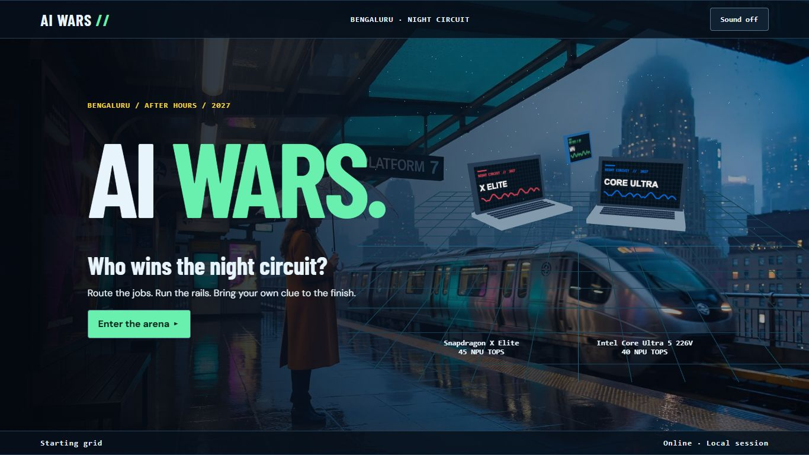

# AI Wars · Bengaluru Night Circuit

A two-minute browser arcade for the CMRIT × Intel 1 Million Minds Challenge. Pick a persona, race a laptop down a neon Bengaluru metro line, then use a real on-device AI model to search the station photo archive.



## Run the game

Use Node.js 22.12 or later and npm. From the repository root:

```sh
npm ci
npm run play
```

Open the local URL printed by Vite. This builds and serves the production game, including the offline cache. For development with live reload, use `npm run dev`.

## Play a round

| Stage | What the player does |
| --- | --- |
| Starting grid | Enter the arena or wait ten seconds. Pick Creator, Gamer, Student or Hustler to set the relay jobs and suggested search. |
| Engine relay | Route project logic to the CPU, graphics to the GPU and a supported AI task to the NPU. Beat the arcade ghost for 100 points and a shield. |
| Night run | Change lanes with **← / →**, **A / D**, swipe or the on-screen controls. Avoid red obstacles and collect green diamonds. The run ends when time or lives run out. |
| Archive sprint | Enter a clue such as *a red umbrella on wet pavement*. The game ranks 42 photos, shows the top three matches and reports the measured query time. |
| Finish line | See a persona- and score-based laptop suggestion. Compare the other price point, open the retailer listing or use **Show me in store** to get a model-specific demo request. |

## What the Intel showcase demonstrates

The relay and runner use arcade timings. Both featured platforms have dedicated NPUs. Intel lists 40 peak INT8 NPU TOPS for the Core Ultra 5 226V, and Qualcomm lists up to 45 NPU TOPS for Snapdragon X Elite. An application benchmark requires the same workload on both devices. [Intel specifications](https://www.intel.com/content/www/us/en/products/sku/240960/intel-core-ultra-5-processor-226v-8m-cache-up-to-4-50-ghz/specifications.html) · [Qualcomm specifications](https://www.qualcomm.com/laptops/products/snapdragon-x-elite)

The archive sprint runs actual inference. A Web Worker encodes the player’s words with quantized CLIP ViT-B/32 through Transformers.js and ONNX Runtime WebAssembly on the CPU. It compares that vector with the prepared photo embeddings. The displayed latency covers text encoding and ranking after initialization. The optional native OpenVINO utility can separately measure supported CPU and NPU image indexing on compatible hardware. [Search worker](src/worker.js) · [Native benchmark](tools/benchmark.py)

The store cards use the Acer Swift Go 14 (NX.KSMSI.002) and ASUS Zenbook S 14 (UX5406SA-PZ555WS). Indicative prices were checked on 25 November 2026. Each card links to its retailer for current pricing and availability. [Catalogue and recommendation logic](src/scenes/end.js)

## Offline demonstration and submission

1. Open the production game on localhost or an HTTPS host. Wait for **Offline pack ready** in the footer. Allow time on the first visit for the local model and runtime download.
2. Disconnect the network, enter a fresh clue in the archive sprint and inspect the results. Reload the game to verify that the cached application also starts offline.
3. For the competition URL, build with `npm run build` and deploy the **contents of `dist/`** to a public HTTPS static host. Check the published URL in a fresh browser before submitting it.

## Verification and development

Run `npm run verify` with Chrome installed. It builds the production game and uses Playwright to check the title, relay inputs, runner controls, offline search, retail recommendation, narrow-screen layout and disconnected reload. [Browser test](tools/check.mjs) · [Runner screenshot](qa/arena-run.jpg) · [Offline search screenshot](qa/arena-search.jpg)

The game uses vanilla JavaScript, Vite and Three.js r169. The runner includes a lightweight fallback for browsers without WebGL. The text model and prepared image index are checked in, so a fresh checkout can play immediately after installation. To regenerate the index after changing the photos, place the matching checkpoint’s `vision_model_quantized.onnx` under `tools/vision/onnx/`, run `npm run index`, then rebuild. [Model checkpoint](https://huggingface.co/Xenova/clip-vit-base-patch32) · [Indexing script](tools/index.mjs)

The station artwork was supplied for the project. The archive photographs and illustrative laptop artwork were generated for the prototype. Barlow Condensed and DM Sans are packaged locally through Fontsource.
